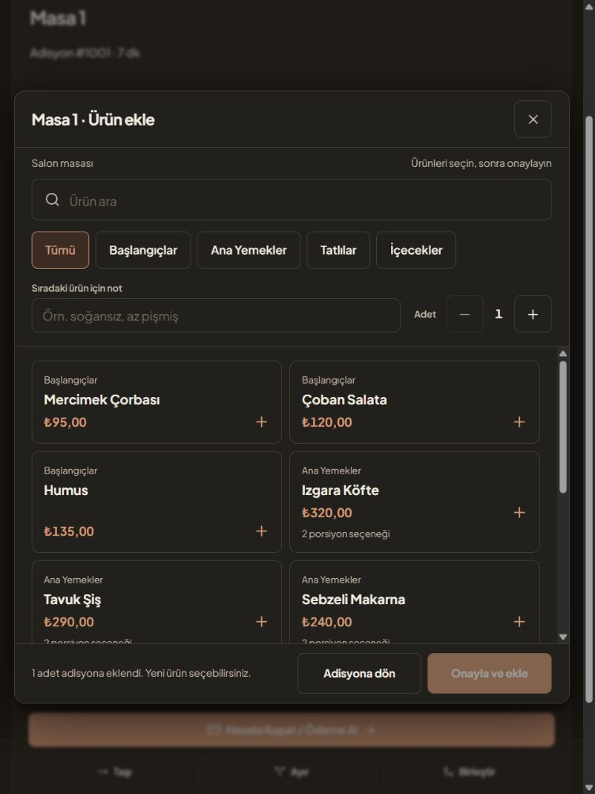

> ### Batuhan'dan Not
>
> Test için böyle bir şey denedim veritabanı vs zaten olmadığı için öylesine denemelik birşeyler yaptırdım 6.11.2026 // 22.08
> PlatinMarket, Entegra, POS gibi canlı bağlantılar için veritabanı şeması ile ilgili sağlayıcı erişimleri gerekiyor.

# ATIA Restoran Web

ATIA'nın masaüstü restoran uygulamasını web ortamına taşıyoruz. Bu depoda personel ekranları, API ve tarayıcıda açılan müşteri menüsü birlikte duruyor. Şu anki sürüm, restoran akışlarını **demo verisiyle** denemek için çalışıyor; gerçek mağaza veritabanına bağlı değil.

Arayüzde masa ve adisyon işlemleri, mutfak fişleri, paket servis, günlük rapor, menü yönetimi, gelen sipariş kutusu ve rezervasyon var. Giriş ekranı korunarak diğer personel ekranları yeniden düzenlendi. Masaüstünden hangi özelliklerin taşınmaya değer olduğunu ve hangi bağlantıların beklediğini [geçiş analizinde](MASAUSTU_GECIS_ANALIZI.md) anlattık.

### Ekranlardan örnekler




## Bugün neler çalışıyor?

| Alan | Demo ortamında yapabilecekleriniz | Sınır |
| --- | --- | --- |
| Masalar ve adisyon | Bölüm veya duruma göre masa bulma; ürün, porsiyon ve sipariş notu ekleme; adet değiştirme; gerekçeli iptal veya zayi; ödeme alma; masa taşıma, ayırma ve birleştirme | İşlemler bellekte tutulur. Sunucu yeniden başlayınca sıfırlanır. |
| Mutfak | Ürünleri ayrı ayrı hazır işaretleme; bildirimleri yazdırma kuyruğunda izleme, yazdırma denemesi ve sonucu kaydetme | Yazdırma tarayıcının yazdırma penceresini açar; başarı veya hata personel tarafından işaretlenir, fiziksel çıktı otomatik doğrulanmaz. |
| Paket servis | Müşteri, telefon, adres, ürün ve ödeme şekliyle sipariş açma; kurye atayıp siparişi hazırlama, yola çıkarma ve teslim etme | Manuel demo akışıdır. Çevrim içi sipariş sağlayıcılarından otomatik kayıt almaz. |
| Günlük rapor | İşletme gününe göre masa ve teslim edilmiş paket satışlarını ayrı ve toplam gösterme; ödeme türleri, saatlik masa tutarları, iptal/zayi, işlem geçmişi ve mutabakatı görme | Paket ödemesi sadece seçilen ödeme şekli olarak kayıtlıdır; tahsilat doğrulanmadığı için masa kasası mutabakatına katılmaz. İşlem geçmişi sunucu yeniden başlayınca sıfırlanır. |
| Rezervasyon | Tarihe göre kayıt görme, yeni rezervasyon açma ve iptal etme | Az kullanılan bir akış olduğu için ikincil menüdedir. |
| Menü | Yöneticinin kategori, ürün, porsiyon, fiyat ve görünürlüğü düzenlemesi; personelin ürünleri araması; müşterinin `/menu` adresinden aktif ürünleri görmesi | Müşteri menüsü sipariş göndermez; değişiklikler demo belleğinde kalır. |
| Gelen siparişler | PlatinMarket veya Entegra kaynaklı örnek siparişi elle girme, ürün kodunu eşleme ve paket servise aktarma; aynı kaynak ve sipariş numarasını ikinci kez aktarmama | Sağlayıcıdan otomatik sipariş çekmez; tek ürün satırlı demo kaydıdır. |
| POS | Adisyon ödemesinde manuel POS veya Hugin S1/PayGo için örnek işlem ve sonuç sorgulama | Fiziksel terminale bağlanmaz. Onay adımı simülasyondur. |

### Masadan ödemeye

Garson veya yönetici masayı seçip menüden ürün ekleyebilir. Ürün seçici masa ekranının üzerinde açılır; tablet ve dokunmatik bilgisayarda kategori, arama, adet, porsiyon ve sipariş notu aynı panelden kullanılır. Seçilen ürünler onay bekler; **Onayla ve ekle** işleminden sonra panel açık kalır, böylece aynı masaya başka ürünler de girilebilir. Yönetici gerektiğinde ürün ikramını işaretler, adisyonu başka masaya taşır, ayırır veya birleştirir.

Ödeme ekranı nakit, banka kartı, yemek kartı, cari ve indirim tutarlarını ayrı alır. Kısmi ödeme yapılırsa kalan tutar adisyonda görünür; tutar tamamlandığında adisyon kapanır. Sunucu ürün fiyatını ve ödeme toplamını denetler. Hugin S1 ve PayGo seçimi, gerçek cihazla konuşan bir bağlantı değil, işlem durumlarını denemek için hazırlanmış simülasyondur.

Yönetici günlük raporda gerekçeli iptal, zayi, ikram, ödeme ve masa işlemlerini yapan personeli görebilir. İptal ve zayi tutarları ayrı gösterilir. İşletme günü varsayılan olarak 04.00'te başlar; `Restaurant__BusinessDayStartHour` ortam değişkeniyle 0–23 arasında ayarlanabilir. Tamamlanmış bir işletme günü için yönetici sayılan nakdi girip vardiyayı bir kez kapatabilir; rapor beklenen nakit ile farkı gösterir. Rezervasyonlar normal takvim gününü kullanır. Fiziksel POS veya banka iadesi henüz uygulanmadı. Bu kayıtlar da demo belleğindedir, kalıcı denetim kaydı sayılmaz.

### Paket siparişinin yolu

Yeni siparişte müşteri ve teslimat bilgileriyle ürünleri girersiniz. Sipariş **Yeni → Hazırlanıyor → Yolda → Teslim edildi** sırasıyla ilerler. Yola çıkarırken kurye adı gerekir. Ürün fiyatları sunucudaki menüden alınır; tekrar gönderilen isteğin ikinci bir sipariş açmaması için işlem anahtarı kullanılır. Bu akış henüz gerçek müşteri ve sipariş tablolarına bağlı değildir.

Yönetici **Entegrasyonlar → Gelen sipariş kutusu** bölümünde PlatinMarket veya Entegra adına örnek bir sipariş ekleyebilir. Kaynak ürün kodu menüdeki stok koduyla uyuşursa ürün kendiliğinden eşleşir; uyuşmazsa yönetici ürün seçer. **Paket servise aktar** işlemi aynı gelen siparişi ikinci kez paket siparişine dönüştürmez. Siparişin fiyatı aktarma sırasında sunucudaki aktif menüden alınır. Bu kutu sağlayıcıdan canlı veri almaz; gerçek bağlantı için sağlayıcı sözleşmesi, erişim bilgileri ve doğrulanmış veritabanı şeması gerekir.

### Menü ve mutfak

Yönetici menü ekranında kategori ve ürün ekleyebilir, adları ve fiyatları düzenleyebilir, porsiyon tanımlayabilir ve ürünü müşteri menüsünden kaldırmak için pasifleştirebilir. Ürün değişiklikleri yeni siparişleri etkiler; mevcut adisyon satırlarının kaydedilmiş fiyatını geriye dönük değiştirmez.

Mutfak bildirimlerinde yazdırma denemesi kuyrukta görünür. Tarayıcının yazdırma penceresi açıldıktan sonra mutfak personeli **Yazdırıldı** veya **Yazdırılamadı** sonucunu kaydeder. Hatalı kayıt tekrar denenebilir; başarılı sonuçtan sonra bildirim görüldü olarak işaretlenebilir. Tarayıcı gerçek kâğıt çıktısını doğrulayamadığı için bu adım personel onayına dayanır.

### Kim hangi ekrana girer?

| Rol | Erişim |
| --- | --- |
| Yönetici (`admin`) | Genel bakış, masalar, paket servis, mutfak, menü ve ürün yönetimi, günlük rapor, gelen sipariş kutusu ve rezervasyonlar. Ödeme ve masa taşıma gibi yönetici işlemleri bu roldedir. |
| Garson (`garson`) | Masalar, sipariş ve paket servis akışı, menü. |
| Mutfak (`mutfak`) | Mutfak fişleri ve menü. |
| Müşteri | Giriş yapmadan `/menu` adresindeki salt okunur menü. |

İşlem izinleri sunucuda ayrı denetlenir: garson sipariş ve gerekçeli iptal yapar; zayi, ikram ve ödeme yöneticiye; ürün hazırlığı ve mutfak bildirimleri mutfak personeli ile yöneticiye açıktır. Personel ekranları telefonda ve masaüstünde açılır. Açık ve koyu tema bulunur. Sunucu, değişikliklerden sonra SignalR üzerinden personel ekranlarına yenileme sinyali gönderir.

## Yerelde çalıştırma

Gerekenler: [.NET 10 SDK](https://dotnet.microsoft.com/download/dotnet/10.0). Depodaki derlenmiş arayüz `wwwroot` altında bulunduğu için yalnızca uygulamayı açacaksanız Node.js gerekmez.

Windows'ta [AtiaBaslat.bat](AtiaBaslat.bat) dosyasına çift tıklayın. Dosya sunucuyu başlatır ve hazır olduğunda giriş sayfasını tarayıcıda açar. Sunucu komut penceresi açık kaldığı sürece çalışır.

Depo kökünde:

```powershell
dotnet run --environment Development --urls "http://0.0.0.0:5080"
```

Sunucu bilgisayarında personel girişi için `http://127.0.0.1:5080/login` adresini açın. Diğer bilgisayarlarda `127.0.0.1` yerine sunucunun yerel ağ IP adresini yazın: `http://SUNUCU-IP:5080/login`. Müşteri menüsü aynı adreste `/menu`, API ise `/api` altında çalışır. Windows Güvenlik Duvarı bağlantıyı engelliyorsa 5080 portuna izin verin.

### Demo hesapları

Bu hesaplar yalnızca `Development` ortamındaki demo modunda kullanılabilir. Üç hesabın parolası da `demo123`.

| Rol | Kullanıcı adı | Parola |
| --- | --- | --- |
| Yönetici | `admin` | `demo123` |
| Garson | `garson` | `demo123` |
| Mutfak | `mutfak` | `demo123` |

Demo sunucuya erişebilen diğer bilgisayarlardan da açılır. Üç hesabın giriş bilgileri bu depoda açıkça yer aldığı için erişimi ağ düzeyinde kısıtlamadan gerçek işletme verisiyle kullanmayın. İmzalı oturum belirtecindeki rol sunucuda doğrulanır; istek gövdesindeki rol veya personel alanı yetki vermez. Demo siparişleri, rezervasyonları ve ödemeleri kalıcı değildir. Sunucuyu yeniden başlattığınızda başlangıç verisine dönersiniz.

### Arayüz üzerinde çalışmak

[Node.js](https://nodejs.org/) 20 veya üzeri ile iki terminal kullanın. İlk terminalde yukarıdaki .NET komutu açık kalsın. İkinci terminalde:

```powershell
cd ClientApp
npm ci
npm run dev
```

Vite arayüzü `http://127.0.0.1:5173` adresinde açar ve API ile SignalR isteklerini 5080 portuna iletir. Arayüz değişikliklerini .NET sunucusunun sunduğu sürüme aktarmak için `ClientApp` içinde `npm run build` çalıştırın; çıktı `wwwroot` klasörüne yazılır.

## Kodun düzeni

- `Program.cs`: API rotaları, rol kuralları, oturum açma, SignalR ve statik dosyalar.
- `Data/RestaurantRepository.cs`: Demo veri ve masa, ödeme, mutfak, paket servis iş kuralları.
- `Models/`: API istekleri ve veri modelleri.
- `ClientApp/src/`: React ekranları, oturum yönetimi ve arayüz stilleri.
- `Tests/`: API sözleşmesi ve iş kuralı testleri.
- `wwwroot/`: Derlenmiş arayüz; .NET uygulaması bu dosyaları sunar.

Sunucu ASP.NET Core 10, arayüz React 19, TypeScript ve Vite ile yazıldı. TanStack Query veri isteklerini, SignalR değişiklik bildirimlerini yönetir. Personel oturumu JWT kullanır. Demo verileri bellekte tutulur; `Data/DbContext.cs` içindeki SQL sınırı doğrulanmış bir canlı bağlantı değildir.

## Testler

Depo kökünde API testleri:

```powershell
dotnet test Tests/AtiaRestorant.API.Tests.csproj
```

`ClientApp` içinde arayüz testleri ve üretim derlemesi:

```powershell
cd ClientApp
npm ci
npm test
npm run build
```

8 Kasım 2026 kontrolünde 39 API ve 16 arayüz testi geçti; TypeScript denetimi ve üretim derlemesi de tamamlandı. Testler menü ve gelen sipariş yetkilerini, fiyatın sunucuda belirlenmesini, mükerrer kayıt korumasını, paket raporunu ve yazdırma kuyruğunun durum geçişlerini kapsıyor. [Önceki doğrulama notu](VERIFICATION.md) 6 Kasım tarihli bir anlık kayıttır, bu yüzden oradaki test sayıları daha düşüktür.

## Canlı kullanımdan önce

`Demo:Enabled=false` ayarı gerçek veritabanını açmaz. SQL şeması henüz doğrulanmadığı için API, sağlık kontrolü dışındaki isteklerde 503 yanıtı verir. Demo modu da geliştirme ortamı dışında başlatılmaz. Bu sürümü mağazada canlı tahsilat veya sipariş kaydı için kullanmayın.

Geçiş için şu bilgilere ihtiyaç var:

1. Masa, adisyon, sipariş satırı, ödeme, ürün, müşteri, paket servis ve mağaza ayarlarının gerçek veritabanı şeması; mümkünse kişisel verisi ayıklanmış örnek kayıtlar.
2. Hangi mağazanın PlatinMarket, Entegra, Hugin/PayGo, e-Adisyon veya arayan numara donanımını kullandığı.
3. Kullanılan sağlayıcıların güncel API belgeleri ve test erişimleri. Erişim bilgileri depoya yazılmamalı.
4. Masaüstü uygulamasıyla web aynı veriyi kullanacaksa eşzamanlı işlem, mükerrer sipariş ve mükerrer tahsilat kuralları.

Önce canlı veri eşlemesi ve mağaza bazlı yetki sınırları kurulmalı. Ardından paket servis ve gerçekten kullanılan sipariş kaynakları bağlanabilir. Fiziksel POS, yazıcı ve arayan numara donanımı ayrı bağlantı çalışmaları gerektirir. Ayrıntılı sıra ve masaüstü kodundaki karşılıklar [geçiş analizinde](MASAUSTU_GECIS_ANALIZI.md) bulunuyor.
